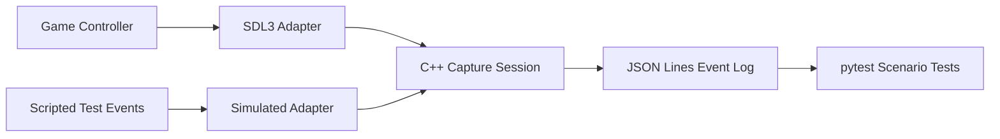

# CoreProbe v0.1 Architecture

**Status:** Design draft

CoreProbe is a C++20 framework for device testing and diagnostics. It uses adapters to connect to different devices. The Nintendo Switch Pro Controller is the first hardware example.

## Components

- **Device adapters** convert device input into a common event format. The SDL3 adapter reads button, axis, and disconnect events. The simulated adapter emits a predefined sequence of events so tests can run without hardware.
- **C++ capture session** reads events from an adapter, handles timeouts and disconnects, and writes one JSON object per line. Each event includes a device ID, a timestamp, an event type, and a payload. The adapter defines device-specific event types and payload fields.
- **Python test suite** uses pytest to run the C++ executable and check the event log. Example scenarios verify that a button press precedes its release and that a disconnect ends the capture session. GitHub Actions runs the simulated scenarios. Interactive tests with a physical controller run locally.

## Open Design Question

Define how an adapter reports an event, a read timeout, a device disconnect, or a read error. Use a serial temperature sensor as a design check. Adding it should require a new adapter and sensor-specific tests while reusing the capture session, timeout handling, and event logging.